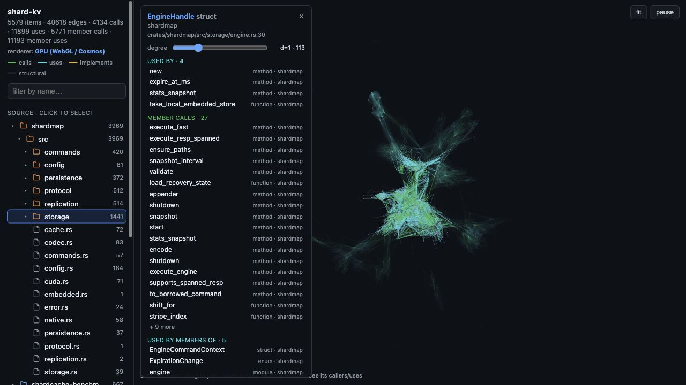

# build-graph

Keep Rust **`ARCHITECTURE.md` files accurate** with a code graph built from the
compiler's view of your workspace.

`build-graph` turns a Rust project into:

- an AI-readable architecture snapshot that can be updated in CI,
- a queryable symbol/type/call graph for agents and humans,
- and a local browser viewer for exploring crates, symbols, calls, and compiled
  execution flow.

The practical loop is simple: generate the graph, let agents read
`ARCHITECTURE.md` first, then use bounded `find`/`refs` queries when they need
exact code navigation instead of guessing from text search.



## Start Here

### Keep `ARCHITECTURE.md` Fresh In CI

Add the composite GitHub Action to any Rust repo. It builds the graph, refreshes
the generated section of `ARCHITECTURE.md`, and commits only when the
graph-derived architecture facts changed.

```yaml
name: Architecture docs

on:
  workflow_dispatch:
  schedule:
    - cron: "0 9 * * 1"

permissions:
  contents: write

jobs:
  architecture:
    runs-on: ubuntu-latest
    steps:
      - uses: actions/checkout@v4

      - uses: d-tietjen/build-graph@master
        with:
          manifest-path: Cargo.toml
          architecture-path: ARCHITECTURE.md
          references-backend: rustc-driver

      - name: Commit architecture update
        run: |
          if git diff --quiet -- ARCHITECTURE.md; then
            echo "ARCHITECTURE.md is already current"
            exit 0
          fi
          git config user.name "github-actions[bot]"
          git config user.email "41898282+github-actions[bot]@users.noreply.github.com"
          git add ARCHITECTURE.md
          git commit -m "Update architecture documentation"
          git push
```

The action replaces only the block between
`<!-- build-graph:architecture:start -->` and
`<!-- build-graph:architecture:end -->`, so hand-written narrative can live
outside the generated section.

See [docs/github-action.md](docs/github-action.md) for PR-based workflows,
inputs, backend choices, and agent guidance.

### Use The CLI Locally

```bash
rustup toolchain install nightly-2026-02-27 --component rustc-dev --component llvm-tools-preview
cargo install build-graph --locked --features rustc-driver

cargo build-graph build --driver --nightly nightly-2026-02-27
cargo build-graph view
```

Use `cargo build-graph watch --driver --nightly nightly-2026-02-27` to refresh
on save. The driver collects MIR during `cargo check`, so the execution model
describes the recorded branches, loops, calls, and unwind paths of that build.

- Open **Graph controls** to switch between **Field** and **Function graph**,
  choose a layout, or adjust package visibility.
- Select a function to see its callers and callees. Use **Call paths** to find
  the captured routes between two functions.
- Open **Execution flow** for the full captured statechart. Use **Flamegraph**
  or **UML sequence** on a function to inspect a bounded request variant.

The [viewer walkthrough](docs/cli-reference.md#explore-the-viewer) covers every
sidebar tab and explains how to read the results.

For symbols and references using the rust-analyzer SCIP backend, run the
following with the matching nightly and the rust-analyzer component installed.

```bash
cargo install build-graph --locked
cargo build-graph build --references --nightly nightly-2026-02-27
```

See [docs/cli-reference.md](docs/cli-reference.md) for all commands, outputs,
Layer 3 backend tradeoffs, and query examples.

### Add The Build Dependency

For a lightweight Layer 1 graph on every `cargo build`, add the helper to any
crate you want graphed:

```toml
[build-dependencies]
build-graph = "0.3"
```

```rust
fn main() {
    build_graph::Builder::new().run();
}
```

Cargo re-runs a crate's build script only when that crate changes, so fragments
merge incrementally into one workspace graph. This path deliberately avoids
nested cargo/rustdoc work and produces crates, source files, and `depends_on`
edges. Use the CLI for the rich symbol and reference layers.

## What It Builds

Inspired by [graphify](https://github.com/safishamsi/graphify), but where
graphify parses source with tree-sitter, `build-graph` reads what the compiler
already produced under `target/`.

| Layer | Source | Toolchain | What it adds |
|---|---|---|---|
| **1** | `cargo metadata` + dep-info `.d` files | stable | crates, source files, `depends_on`, `contains` |
| **2** | nightly rustdoc JSON | nightly | modules, structs, enums, traits, fns, methods, fields, signatures, impls |
| **3** | rust-analyzer SCIP or the rustc driver | stable / pinned nightly | `calls`, `uses`, `member_calls`, `member_uses` |

Layer 3 has two backends:

- `--references` uses rust-analyzer SCIP. It is accurate and easy to run, but
  re-indexes the whole workspace.
- `--driver` uses a clippy-style `RUSTC_WORKSPACE_WRAPPER` built with the
  `rustc-driver` feature. It reads HIR during `cargo check`, so cargo re-runs it
  only for changed crates.

On a 108-crate benchmark workspace, the rustc driver cut Layer 3 per-edit
refreshes from **328.5s** to **11.8s** and cold refreshes from **328.5s** to
**93.5s**. It indexes the compiler's semantic def-reference graph, so it is a
faster compiler-grounded source rather than a byte-identical rust-analyzer clone.

## Query The Graph

The graph answers questions text search cannot answer reliably across crates:
who implements a trait, who calls a function, what a type's methods use, or
where a symbol is defined.

```bash
cargo build-graph find Operation --json --out target/build-graph
cargo build-graph refs Operation --relation implements --incoming --json --out target/build-graph
cargo build-graph context OperationExecutor --out target/build-graph
```

The API is deliberately bounded: `find` returns source locations and
relationship counts; `refs` expands one symbol's edges with filters and caps.
Pass a node id from `find` to `refs` when a name is ambiguous.

## Integrations

Editor shells run `cargo build-graph watch` and show the live architecture graph:

- **VS Code**: [integrations/vscode](integrations/vscode)
- **JetBrains / RustRover**: [integrations/jetbrains](integrations/jetbrains)

Agent templates teach coding agents to read `ARCHITECTURE.md` first and use
bounded graph queries before opening source files:

- **Codex**: copy [integrations/codex/AGENTS.md](integrations/codex/AGENTS.md)
  into your project's `AGENTS.md`.
- **Claude Code**: copy
  [integrations/claude-code/CLAUDE.md](integrations/claude-code/CLAUDE.md) into
  your project's `CLAUDE.md`.
- **Any MCP client**: build with `--no-compress` and point graphify's MCP server
  at `target/build-graph/graph.json`.

## Outputs

Artifacts are written to `target/build-graph/` by default:

- `graph.json.gz` or `graph.json` - graphify-compatible data with deterministic
  IDs.
- `graph.html` - the local browser viewer.
- `graph-export.json` - versioned definition identities, full spans, and
  extraction provenance from the CLI; see [export metadata](docs/export.md).
- `GRAPH_REPORT.md` - counts, largest crates, and highly connected nodes.
- `ARCHITECTURE.md` - optional generated architecture section, refreshed by the
  GitHub Action.

## More Docs

- [GitHub Action](docs/github-action.md)
- [CLI, layers, outputs, and query reference](docs/cli-reference.md)
- [Agent analysis API and replay](docs/agent-analysis.md)
- [Changelog](CHANGELOG.md)
- [VS Code extension](integrations/vscode/README.md)
- [JetBrains/RustRover plugin](integrations/jetbrains/README.md)

- [Linux Cargo launch observation protocol](docs/cargo-launch-intent.md)

## License

MIT
